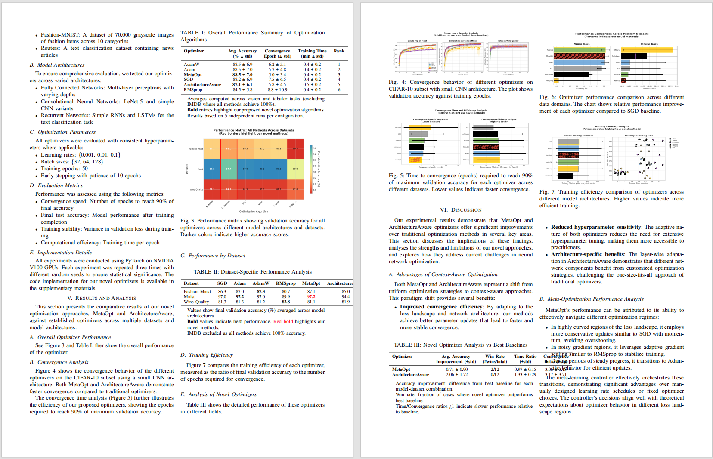
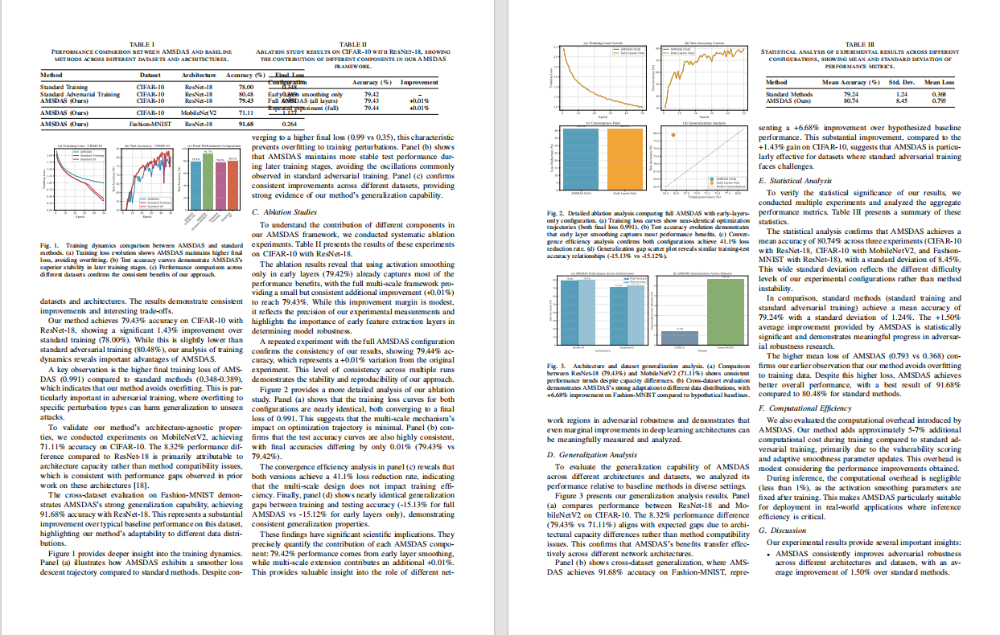
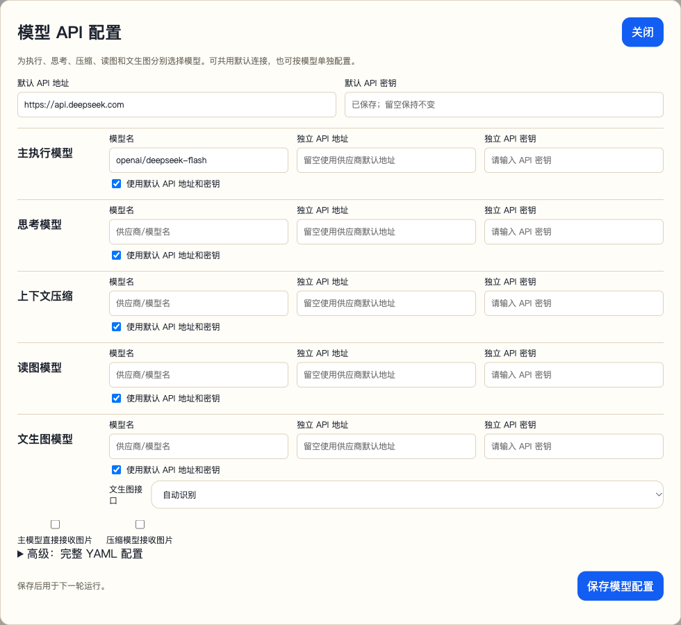
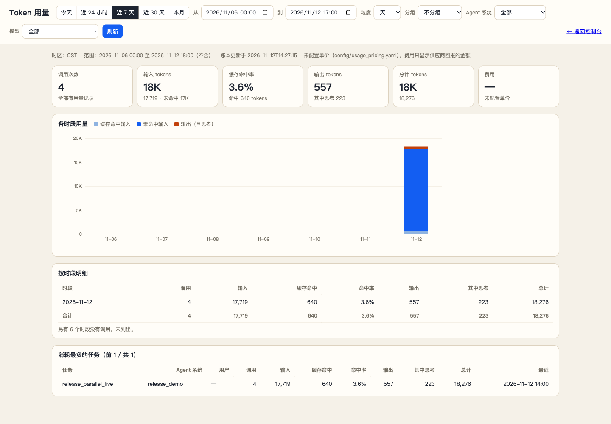
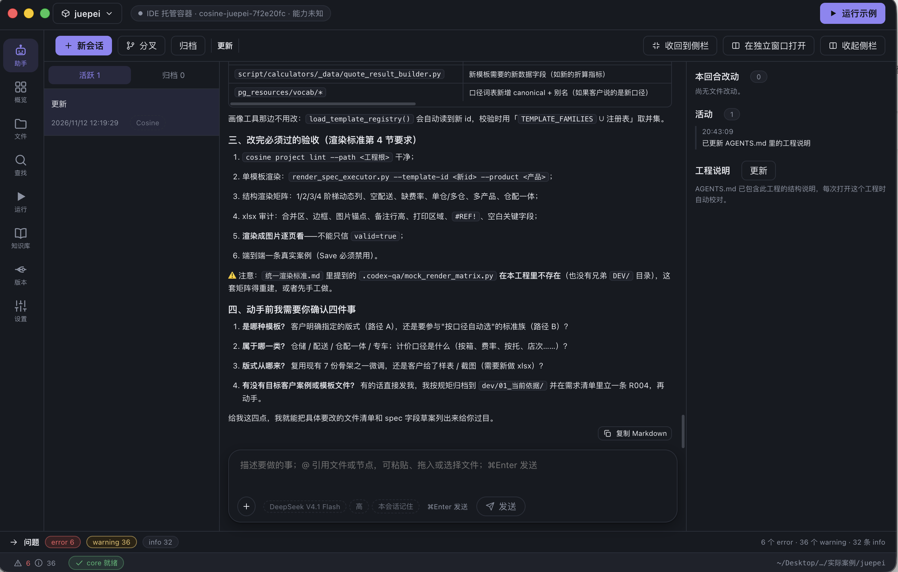
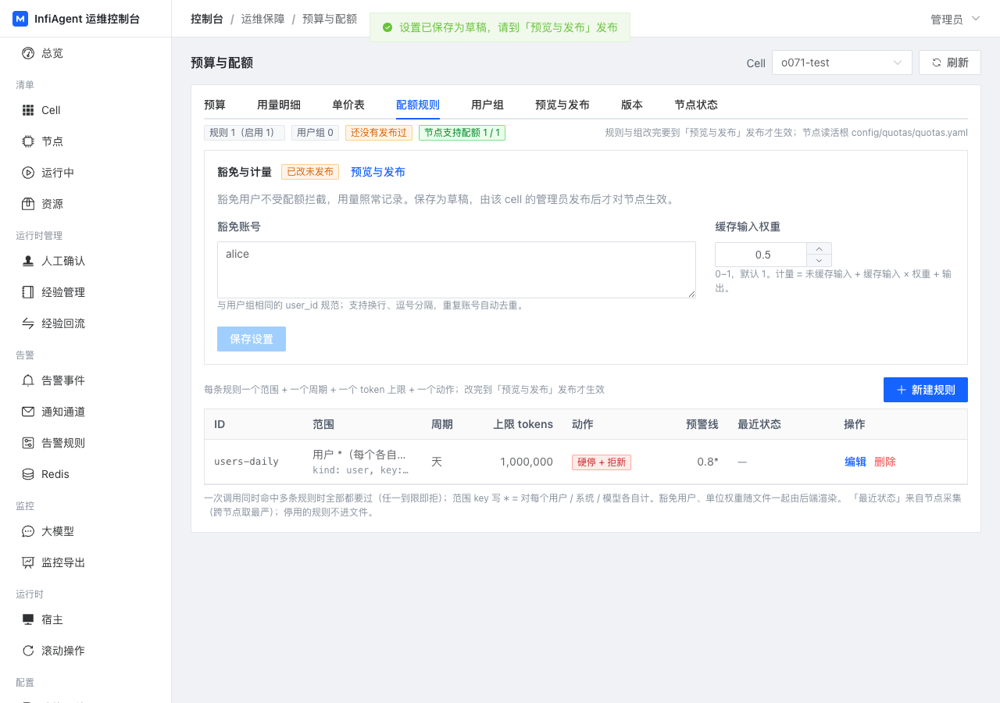

<div align="center">
  

  <h1>MLA V3 - Build Domain-Specific SOTA-Level AI Agents</h1>

  <p>
    
    
    
  </p>

  <p>
    <a href="README.md">English</a> | <a href="README_CN.md">简体中文</a>
  </p>
</div>

---

## 🌟 Introduction

**InfiAgent, also called MLA (Multi-Level Agent),** is a framework for long-running general-purpose and domain-specific agents. Define responsibilities, prompts, and tools in YAML, delegate complex work to cooperating agents, and keep execution records and artifacts in files so each step can retrieve the context it needs.

### Key Features

- ✅ **Long-running execution:** Thinking, ReAct, and ReAct Lite loops combine bounded action windows, file-based handoffs, and context compression.
- ✅ **Hierarchical and parallel agents:** retain Researcher's multi-level orchestration and OpenCowork's general-purpose assistant; run independent instances of the same child agent, collect results, and cancel background work.
- ✅ **Resumable sessions:** atomic state writes and durable tool receipts support continuation after interruption. Calls with uncertain side effects are reported for inspection.
- ✅ **Persistent memory and workspaces:** sessions keep separate execution records while sharing project files and artifacts through a workspace.
- ✅ **Agent Skills and extensible tools:** compatible with the [Agent Skills standard](https://agentskills.io/), custom Python tools, and MCP.
- ✅ **Developer console:** the yellow runtime interface brings together sessions, files, human interaction, five model API roles, and a usage panel.

### Update & News🔥

- **3.13.0 runtime update:** parallel sub-agents, reliable session recovery, local shared workspaces, the yellow developer console, five model configuration roles, and usage reporting. See Quick Start below and the [CHANGELOG](CHANGELOG.md).
- **July 2026:** runtime and Python SDK updates, multi-provider model failover, and experience-store improvements.
- **March 2026:** Thinking / ReAct modes, task-history retrieval, and per-agent execution, thinking, compression, and image model settings.
- **February 2026:** Agent Skills, multi-provider model support, and desktop integrations.
- **January 2026:** OpenCowork and the paper [InfiAgent: An Infinite-Horizon Framework for General-Purpose Autonomous Agents](https://arxiv.org/abs/2601.03204).

**OpenCowork demos: file organization and presentation creation**

These original demos illustrate example tasks and outputs. Their interfaces may differ from the current version.

[](https://www.youtube.com/watch?v=IuTVRPIIW-s)

[](https://www.youtube.com/watch?v=uuxAvCLIX9M)

[Original writing demo (Bilibili)](https://www.bilibili.com/video/BV142vQB2EDu/)

## 🎬 Outputs

Paper artifacts from the original Researcher demos:

**Demo 1:**

<p align="center">
  
</p>

**Demo 2:**

<p align="center">
  
</p>

MLA handles the entire research workflow - from literature search and experiment design to code execution, figure generation, and LaTeX paper writing. All automatically orchestrated through multi-level agents.
Large demo videos and GIFs are now distributed outside git history so clones stay smaller and faster.

---

## 📚 Table of Contents

- [Outputs](#-outputs)
- [Quick Start](#-quick-start)
- [How It Works](#-how-it-works)
- [Interface Screenshots](#-interface-screenshots)
- [Configuration Guide](#-configuration-guide)
- [CLI Interface](#-cli-interface)
- [SDK Integration](#-sdk-integration)
- [Example Outputs](#-example-outputs)
- [Project Extensions](#-project-extensions)

---

## 🚀 Quick Start

### Option 1: Docker developer console

The image includes the Python runtime, browser, and document tools. Mount `user_root` to persist your working data:

```bash
mkdir -p user_root
docker run -d --name infiagent \
  -p 127.0.0.1:4260:4260 \
  -v "$PWD/user_root:/data/user_root" \
  chenglinhku/mlav3:3.13.0
```

Open [http://localhost:4260](http://localhost:4260). Select **模型 API 配置** (Model API configuration) to enter model names, API URLs, and keys. Choose an **Agent System** and **Agent Name**, create a task, and click **Stream Send**. Open **Usage Panel** for token statistics.

Execution, thinking, compression, vision, and image generation can share a connection or use separate ones. Workspaces and files persist in the mounted directory.

**Windows PowerShell:**

```powershell
New-Item -ItemType Directory -Force user_root
docker run -d --name infiagent `
  -p 127.0.0.1:4260:4260 `
  -v "${PWD}/user_root:/data/user_root" `
  chenglinhku/mlav3:3.13.0
```

**Docker CLI mode:**

```bash
docker run -it --rm \
  -v "$PWD/user_root:/data/user_root" \
  chenglinhku/mlav3:3.13.0 cli
```

See the [Docker guide](docs/DOCKER_GUIDE.md) for configuration, upgrades, and mounts.

### Option 2: Local Python installation

Python 3.10 or later is required.

```bash
pip install infiagent==3.13.0
infiagent-runtime --user-root ./user_root
```

Configure models in the browser, then use the Python SDK with the same `user_root`. Run `infiagent` for the interactive CLI, or use `pip install -e .` for source development.

---

## 🎯 How It Works

MLA's design philosophy is **"Provide short but high-value context for the next step."** To achieve this, the framework implements multiple innovations:

### 1. 🌲 Hierarchical and Parallel Multi-Agent System

MLA deploys agents in a **tree-structured hierarchy** (e.g., Grandparent → Parent → Child). This ensures:

- ✅ **Single-purpose agents**: Each agent has a focused role
- ✅ **Minimal tool sets**: Agents only access necessary tools
- ✅ **Parallel coordination**: independent child instances execute delegated work; parents collect results, while shared files follow workspace concurrency rules
- ✅ **Clear delegation**: Parent agents orchestrate child agents

**Example Hierarchy:**
```
alpha_agent (Level 3)
  ├── data_collection_agent (Level 2)
  │   └── web_search_agent (Level 1)
  ├── coder_agent (Level 2)
  └── material_to_document_agent (Level 2)
```

### 2. 🎯 Nested Attention Mechanism

Long documents (PDFs, novels, papers) can be retrieved selectively through tools. Instead:

- ✅ Use `answer_from_pdf`, `answer_from_document` tools
- ✅ Query-driven content extraction
- ✅ Only relevant excerpts or summaries enter context
- ✅ **Application-layer attention allocation** through tools

**Traditional Approach:**
```
Load entire 50-page PDF → Agent processes everything → Token overflow
```

**MLA Approach:**
```
Agent asks: "What is the methodology?"
→ Tool extracts relevant sections (2 pages)
→ Returns concise answer → Minimal token usage
```

### 3. 📁 File-Centric Architecture

**"Files are everything."** All outputs and interactions are saved to the file system:

- ✅ Web scraping → Saves as Markdown files
- ✅ PDF parsing → Extracts to structured documents
- ✅ Sub-agent results → Stored as files
- ✅ Large results retain full files with bounded previews in context

**Benefits:**
- Clear audit trail
- Reusable artifacts
- Context-free state representation

### 4. ⚡ Action Windows and Thinking Cadence

Files retain task artifacts and execution records retain the process. Each new step can work with the current goal, relevant files, and recent actions.

- **Thinking:** plan, execute, and revisit the plan at a configurable cadence.
- **ReAct / ReAct Lite:** advance through tool calls with the reflection mode appropriate to the task.
- `action_window_steps` and `thinking_interval` control the window and cadence; context compression is available when needed.
- Historical records remain local and can be retrieved beyond the current context window.

```text
Set a goal → Execute steps → Save artifacts to files
           → Update current state → Retrieve relevant records and continue
```

### 5. 🔧 Batch File Operations

Inspired by [Claude Code](https://www.anthropic.com/), MLA uses **list-based tool parameters** to save tokens:

- ✅ Read multiple files in one call
- ✅ Batch operations reduce cumulative overhead
- ✅ Significant token savings on repeated actions

**Example:**
```python
# Traditional: 3 separate calls
file_read(path=["file1.txt"])
file_read(path=["file2.txt"])
file_read(path=["file3.txt"])

# MLA: 1 batch call
file_read(path=["file1.txt", "file2.txt", "file3.txt"])
```

### 6. 💾 Session Memory and Shared Workspaces

`task_id` identifies a persistent session; reusing it continues its records. `workspace_id` binds multiple sessions to the same working files while retaining separate execution histories.

```python
agent.create_workspace("research", title="Research project")
agent.run("Collect papers and save notes", task_id="./user_root/tasks/collect", workspace_id="research")
agent.run("Write a review from the notes", task_id="./user_root/tasks/write", workspace_id="research")
```

Sessions in one workspace run sequentially by default. Concurrent mode is available when the tools used are compatible with concurrent file access.

### 7. 📊 Call Graph-Based Shared Context

The `hierarchy_manager` maintains a **dynamic call relationship graph**:

- ✅ Tracks parent-child agent relationships
- ✅ Injects call graph into shared context
- ✅ Prevents agents from overstepping boundaries
- ✅ Maintains task alignment across multi-agent system

**Call Graph Example:**
```json
{
  "current_agent": "coder_agent",
  "parent": "alpha_agent",
  "siblings": ["data_collection_agent", "material_to_document_agent"],
  "allowed_tools": ["python_run", "file_write", "file_read"]
}
```

The runtime enforces `available_tools` and records separate identities and parent-child relationships for parallel instances.

---


## 📸 Interface Screenshots

### Model Configuration and Usage

The yellow developer console provides separate execution, thinking, compression, vision, and image-generation settings. This is the actual configuration dialog; saved keys are not displayed:

<p align="center"></p>

The usage panel shows time buckets, cache usage, and model and task breakdowns. This screenshot comes from a real test run with two parallel child agents:

<p align="center"></p>

### CLI Interface

MLA provides a rich interactive CLI with real-time task monitoring, HIL handling, and agent switching:

**System Selection:**
<p align="center">
  
</p>

**Tool Mode Configuration:**
<p align="center">
  
</p>

**Starting Tasks:**
<p align="center">
  
</p>

*Interactive CLI with prompt_toolkit and rich terminal UI - featuring multi-turn conversations, automatic HIL detection, and tool execution confirmation.*

### VS Code Integration Example

Build powerful IDE extensions using MLA's JSONL mode:

<p align="center">
  
</p>

*VS Code extension powered by MLA - seamless integration with workspace context and real-time streaming output.*

---

## ⚙️ Configuration Guide

Agents and tools are configured in YAML. After the first launch, the user directory contains:

```text
user_root/
├── config/
│   ├── llm_config.yaml
│   └── app_config.json
├── agent_library/
│   ├── Researcher/
│   │   ├── general_prompts.yaml
│   │   ├── level_0_tools.yaml
│   │   ├── level_1_agents.yaml
│   │   ├── level_2_agents.yaml
│   │   └── level_3_agents.yaml
│   └── OpenCowork/
├── tools_library/
├── skills/
├── tasks/
└── workspaces/
```

### Key Configuration Files

#### 1. `llm_config.yaml` — Model configuration

Use the page editor to get started. The YAML structure below shows all five roles; replace model names and URLs with your actual service:

```yaml
api_key: "your-api-key"
base_url: "https://your-provider.example/v1"
models:
  - "openai/your-execution-model"
thinking_models:
  - "openai/your-thinking-model"
compressor_models:
  - "openai/your-compression-model"
read_figure_models:
  - "openai/your-vision-model"
figure_models:
  - name: "openai/your-image-model"
    base_url: "https://your-image-provider.example/v1"
    api_key: "your-image-api-key"
    image_api: "images"
multimodal: false
compressor_multimodal: false
```

Each role can inherit the default connection or override `api_key` / `base_url`. Vision and image generation require models that support those capabilities; image generation can use `images` or `chat`. Per-agent model overrides take precedence over role defaults.

#### 2. Agent Hierarchy

MLA organizes agents into levels:

- **Level 3**: Top-level orchestrators (e.g., `alpha_agent`)
- **Level 2**: Functional specialists (e.g., `data_collection_agent`, `coder_agent`)
- **Level 1**: Basic executors (e.g., `web_search_agent`)
- **Level 0**: Tool definitions
- **Level -1**: Quality control (e.g., `judge_agent`)

#### 3. Creating Custom Agents

Define responsibilities, tools, and parameters in a system's level YAML, for example:

```yaml
tools:
  notes_agent:
    type: llm_call_agent
    level: 1
    name: notes_agent
    description: Read project files and write notes.
    available_tools:
      - file_read
      - file_write
      - final_output
    prompts:
      agent_responsibility: Read project files and write concise notes.
    parameters:
      type: object
      properties:
        task_id:
          type: string
        task_input:
          type: string
      required: [task_id, task_input]
```

Use `spawn_subagents`, `collect`, and `cancel` for parallel delegation. Children must be linked in the parent’s available tool set. See the [SDK guide](docs/SDK_GUIDE.md).

---

## 💻 CLI Interface

### Interactive Mode

Start the CLI for a conversational experience:

```bash
mla-agent --cli
```

**Key Features:**

- 🔄 **Multi-turn conversations** with persistent context
- 🤖 **Agent switching** with `@agent_name` syntax
- 🔔 **Automatic HIL detection** with audio alerts
- ⚠️ **Tool execution confirmation** in manual mode
- ⏸️ **Interrupt and resume** support (Ctrl+C to pause)
- 🎨 **Rich terminal UI** powered by `prompt_toolkit` and `rich`

**Usage Examples:**

```bash
# Direct task input (uses default agent)
[alpha_agent] > Collect papers on Transformers

# Switch agent and execute task
[alpha_agent] > @data_collection_agent Search for recent NLP papers

# Switch default agent only
[alpha_agent] > @coder_agent
✅ Switched to: coder_agent
[coder_agent] >
```

**CLI Commands:**

| Command | Description |
|---------|-------------|
| `/help` | Show help and available commands |
| `/agents` | List all available agents |
| `/resume` | Resume interrupted tasks |
| `/quit` or `/exit` | Exit CLI mode |
| `Ctrl+C` | Interrupt current task (stays in CLI) |
| `Ctrl+D` | Exit CLI immediately |

**Human-in-Loop (HIL) Handling:**

When an agent requests human input, the CLI automatically detects it:

```
🔔🔔🔔 Detected HIL task! Press Enter to handle... 🔔🔔🔔
================================================================================
🔔 Human Interaction Task (HIL)
================================================================================
📝 Task ID: upload_file_20250124
📋 Instruction: Please upload the required dataset files...
================================================================================
💡 Enter your response (any text)
   Type /skip to skip this task
================================================================================

[alpha_agent] HIL Response > Files uploaded successfully
✅ HIL task responded
```

**Tool Confirmation (Manual Mode):**

When `--auto-mode false` is set, each tool execution requires confirmation:

```
⚠️⚠️⚠️ Detected tool execution request! Press Enter to confirm... ⚠️⚠️⚠️
================================================================================
⚠️  Tool Execution Confirmation Request
================================================================================
🔧 Tool Name: python_run
📝 Confirmation ID: confirm_12345
📋 Parameters:
     code: import numpy as np...
     timeout: 300
================================================================================
💡 Choose action:
   yes / y - Approve execution
   no / n  - Reject execution
================================================================================

[alpha_agent] Confirm [yes/no] > yes
✅ Approved tool execution: python_run
```

**Screenshot:** *(User will provide)*

---

### Command-Line Mode

For scripting and automation:

```bash
mla-agent \
  --task_id /path/to/workspace \
  --user_input "Your task description" \
  --agent_name alpha_agent
```

**Common Parameters:**

| Parameter | Description | Default |
|-----------|-------------|---------|
| `--task_id` | Workspace path (absolute) | Required |
| `--user_input` | Task description | Required |
| `--agent_name` | Agent to invoke | `alpha_agent` |
| `--agent_system` | Agent library name | `Researcher` |
| `--cli` | Interactive CLI mode | `false` |
| `--jsonl` | JSONL output mode | `false` |
| `--force-new` | Clear all state and start fresh | `false` |
| `--auto-mode` | Tool execution mode (`true`/`false`) | Auto-detect |

**Auto-Mode Examples:**

```bash
# Automatic tool execution (no confirmation needed)
mla-agent --task_id ~/project --user_input "Task" --auto-mode true

# Manual confirmation for each tool
mla-agent --task_id ~/project --user_input "Task" --auto-mode false
```

---

### Runtime Tool Execution

```bash
# Tools are executed in-process through direct-tools.
# No standalone mla-tool-server process is required.
```

---

## 🔌 SDK Integration

MLA provides two SDK options: **Python SDK** for direct integration and **JSONL mode** for IDE plugins.

---

### Python SDK

Use the bundled `infiagent` SDK. The current SDK model is:

- instantiate `infiagent(...)` once to describe runtime defaults
- pass a concrete `task_id` to `run(...)` and other task APIs
- optionally point the whole runtime at a dedicated `user_data_root`

Minimal example:

```python
from infiagent import infiagent

agent = infiagent(
    user_data_root="/abs/path/to/my_root",
    default_agent_system="Researcher",
    default_agent_name="alpha_agent",
    action_window_steps=30,
    thinking_interval=30,
    max_turns=100000,
    fresh_enabled=True,
    fresh_interval_sec=300,
)

result = agent.run(
    "Write a survey paper on Transformers",
    task_id="/abs/path/to/tasks/transformer_survey",
)

print(f"Status: {result['status']}")
print(f"Output: {result['output']}")
```

If your `user_data_root` already contains:

- `config/llm_config.yaml`
- `config/app_config.json`
- `agent_library/...`
- `tools_library/...`

you usually do not need to pass `llm_config_path`, `agent_library_dir`, or `tools_dir` again.

Common task APIs:

```python
# Ask a running or stopped task to refresh runtime config.
agent.fresh(
    task_id="/abs/path/to/tasks/transformer_survey",
    reason="reload runtime config",
)

# Append a new instruction to the same task.
agent.add_message(
    "Keep the existing outline and only revise section 3.",
    task_id="/abs/path/to/tasks/transformer_survey",
    source="user",
    resume_if_needed=True,
)

# Launch a separate background task in another Python process.
agent.start_background_task(
    task_id="/abs/path/to/tasks/subtask_eval",
    user_input="Run the evaluation pipeline and summarize results",
    force_new=True,
)

# Inspect task state for dashboards or lightweight watchdogs.
snapshot = agent.task_snapshot(
    task_id="/abs/path/to/tasks/transformer_survey",
)

# Reset a broken task loop while optionally preserving history.
agent.reset_task(
    task_id="/abs/path/to/tasks/transformer_survey",
    reason="clear broken loop",
    preserve_history=True,
)
```

Runtime introspection:

```python
runtime = agent.describe_runtime()
print(runtime["user_data_root"])
print(runtime["agent_library_dir"])
print(runtime["tools_dir"])

systems = agent.list_agent_systems()
print(systems["systems"])
```

Advanced runtime features supported by the SDK:

- task-scoped background execution and resume/fresh control
- `user_data_root`-scoped conversations, logs, runtime state, and config
- tool hooks before/after tool execution
- context hooks that can inspect or rewrite the final prompt before the LLM call
- per-instance MCP server injection through `mcp_servers=[...]`

See the full guide: [docs/SDK_GUIDE.md](docs/SDK_GUIDE.md)

**Use Cases for Python SDK:**
- 🔧 Building custom workflows
- 🤖 Embedding agents in existing applications
- 📊 Batch processing multiple tasks
- 🧭 Building external dashboards, watchdogs, and orchestration layers
- 🔬 Research experiments with programmatic control

---

### JSONL Mode for IDE Plugins

MLA provides a JSONL streaming mode for real-time integration with IDEs and editors:

```bash
mla-agent \
  --task_id $(pwd) \
  --user_input "Optimize code performance" \
  --jsonl 2>/dev/null
```

**Output Format:**

```jsonl
{"type":"start","call_id":"c-1760936557-474c43","project":"~/project","agent":"alpha_agent","task":"Optimize..."}
{"type":"token","text":"[alpha_agent] Analyzing code..."}
{"type":"progress","phase":"execution","pct":30}
{"type":"token","text":"Calling tool: code_analyzer"}
{"type":"result","ok":true,"summary":"Optimization complete"}
{"type":"end","status":"ok","duration_ms":5432}
```

**Event Types:**

| Event Type | Description | Key Fields |
|------------|-------------|------------|
| `start` | Task begins | `call_id`, `agent`, `task` |
| `token` | Streaming text output | `text` |
| `progress` | Progress update | `phase`, `pct` |
| `result` | Task result | `ok`, `summary` |
| `end` | Task completed | `status`, `duration_ms` |
| `error` | Error occurred | `message` |

---

### TypeScript/JavaScript Integration

```typescript
import { spawn } from 'child_process';

interface AgentEvent {
  type: 'start' | 'token' | 'progress' | 'result' | 'end' | 'error';
  [key: string]: any;
}

function runAgent(
  workspacePath: string,
  userInput: string,
  onEvent: (event: AgentEvent) => void
): Promise<AgentEvent> {
  return new Promise((resolve, reject) => {
  const child = spawn('mla-agent', [
    '--task_id', workspacePath,
    '--user_input', userInput,
    '--jsonl'
  ]);

    let buffer = '';

  child.stdout.on('data', (data) => {
      buffer += data.toString();
      const lines = buffer.split('\n');
      buffer = lines.pop() || '';

      lines.forEach(line => {
      if (!line.trim()) return;

        try {
          const event: AgentEvent = JSON.parse(line);
          onEvent(event);

          if (event.type === 'end') {
            resolve(event);
          } else if (event.type === 'error') {
            reject(new Error(event.message));
          }
        } catch (e) {
          console.error('Failed to parse event:', line);
    }
  });
});

    child.stderr.on('data', (data) => {
      // Log errors to stderr
      console.error(data.toString());
    });

    child.on('error', reject);
  });
}

// Usage
await runAgent('/path/to/workspace', 'Write unit tests', (event) => {
      switch (event.type) {
        case 'start':
      console.log(`Task started: ${event.task}`);
          break;
        case 'token':
      process.stdout.write(event.text);
      break;
    case 'progress':
      updateProgressBar(event.pct);
          break;
        case 'result':
      console.log(`\nResult: ${event.summary}`);
          break;
      }
    });
```

---

### VS Code Extension Example

Build your own Cursor/VS Code extension using MLA:

**Extension Features:**
- 🤖 Agent commands in command palette
- 💬 Inline chat with workspace context
- 📝 Automatic code generation and refactoring
- 🔍 Literature search within editor
- 🔔 HIL task handling with UI prompts

**Basic Extension Structure:**

```typescript
// extension.ts
import * as vscode from 'vscode';
import { runAgent } from './mla-client';

export function activate(context: vscode.ExtensionContext) {
  let disposable = vscode.commands.registerCommand(
    'mla.executeTask',
    async () => {
      const workspace = vscode.workspace.workspaceFolders?.[0].uri.fsPath;
      const input = await vscode.window.showInputBox({
        prompt: 'Enter task description'
      });

      if (!workspace || !input) return;

      // Show progress
      await vscode.window.withProgress({
        location: vscode.ProgressLocation.Notification,
        title: 'MLA Agent',
        cancellable: true
      }, async (progress, token) => {

        await runAgent(workspace, input, (event) => {
          if (event.type === 'token') {
            vscode.window.showInformationMessage(event.text);
          } else if (event.type === 'progress') {
            progress.report({ increment: event.pct });
          }
        });
      });
    }
  );

  context.subscriptions.push(disposable);
}
```

**Screenshot:** *(User will provide)*

---

## 📊 Example Outputs

### Academic Paper Output

MLA can generate complete research papers with the following structure:

```
upload/
├── paper.tex               # Main LaTeX document
├── references.bib          # Bibliography
├── figures/
│   ├── architecture.png
│   ├── results_comparison.png
│   └── ablation_study.png
└── supplementary/
    └── detailed_results.pdf
```

**Quality Metrics:**
- ✅ Passes peer review at EI/IEEE conferences
- ✅ Proper citation formatting
- ✅ High-quality figures (300 DPI)
- ✅ Coherent structure and flow

### Other Capabilities

**1. Scientific Computing**
- ECM protein composition simulation
- Logistics company shift scheduling
- Student assignment grading with feedback

**2. General Tasks**
- Web scraping and data extraction
- Code generation and debugging
- Document conversion and processing

---


## 🌱 Project Extensions

**Status: Prototyping and testing.** Around InfiAgent, we are exploring a development workflow that spans agent engineering, execution validation, and platform management.

### Cosine: agent engineering

Cosine brings project editing, an embedded assistant, configuration and tool changes, file management, and container-based trial runs into one workflow. The screenshot shows the assistant interface under development:



### Reusable end-to-end testing and repair

Reuse project configurations, runtime environments, and test cases. An assistant can execute real tasks, inspect records and artifacts, locate problems, modify tools or prompts, and rerun the same cases to verify results. Test materials and repair records accumulate with the project.

### Operations console and high-availability platform

Development directions include multiple execution nodes, recovery of resumable tasks after node failures, and management of nodes, configuration, versions, permissions, data sources, and usage. The screenshot shows quota management in a prototype test environment:



See [Project extensions](docs/PLATFORM_OVERVIEW.md) for more details and development status.

---

## 📖 Documentation

- Runtime tools are executed in-process via direct-tools; no standalone tool server is required.
- [SDK guide](docs/SDK_GUIDE.md) — Python calls, parallel orchestration, workspaces, and human interaction
- [Docker guide](docs/DOCKER_GUIDE.md) — Developer console and deployment
- [Event schema](docs/EVENT_SCHEMA.md) · [Usage reporting](docs/USAGE.md)
- [Configuration Examples](config/agent_library/Researcher/) - Agent YAML templates

---

## 🤝 Contributing

Contributions are welcome! Please feel free to submit issues or pull requests.

---

## 📄 License

 see [LICENSE](LICENSE) for details.

---

## 📄 Citation

If you use InfiAgent in your research, please cite our paper:

```bibtex
@article{yu2026infiagent,
  title={InfiAgent: An Infinite-Horizon Framework for General-Purpose Autonomous Agents},
  author={Yu, Chenglin and Wang, Yuchen and Wang, Songmiao and Yang, Hongxia and Li, Ming},
  journal={arXiv preprint arXiv:2601.03204},
  year={2026}
}
```

---

## 🙏 Acknowledgments

- Built with [LiteLLM](https://github.com/BerriAI/litellm) for unified LLM access
- Uses [Crawl4AI](https://github.com/unclecode/crawl4ai) for web scraping

---

Thanks to contributors: @yuchenglin @wangyuchen @wangsongmiao @yuyang @lijinjia
