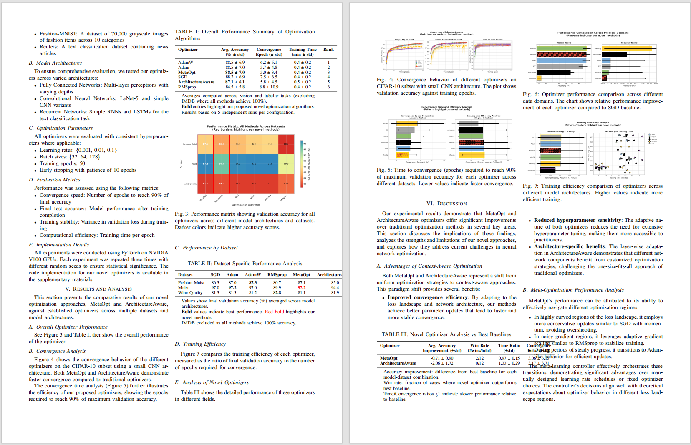
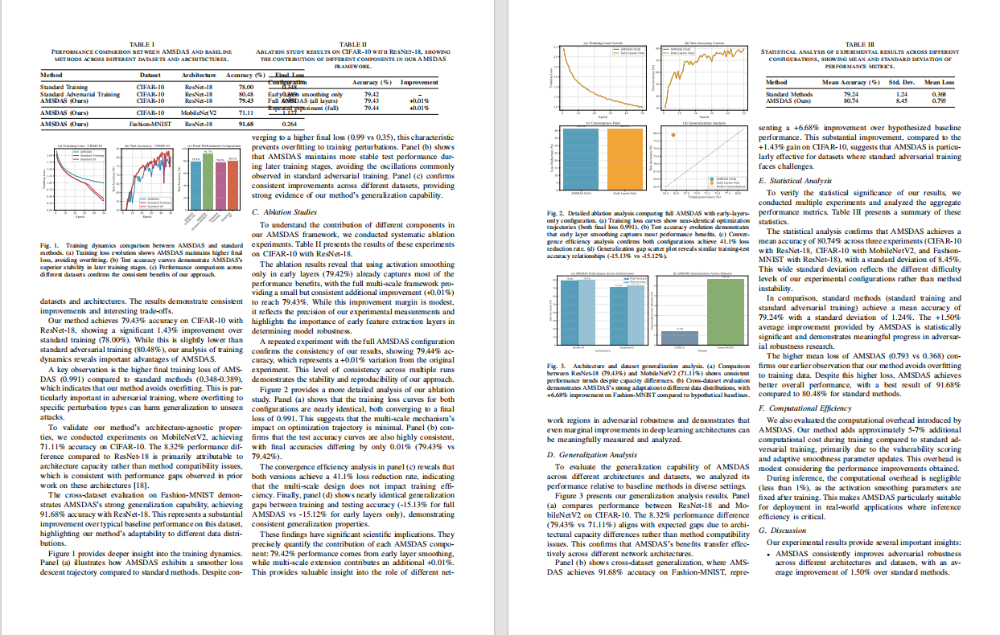
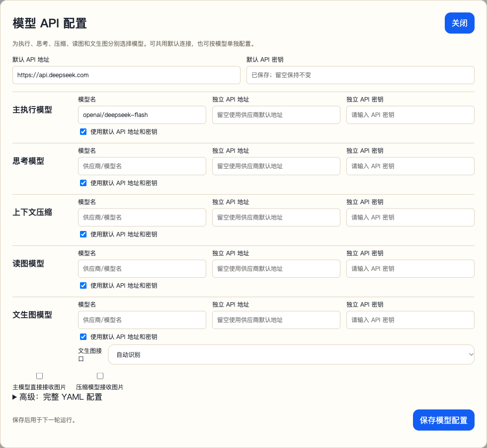
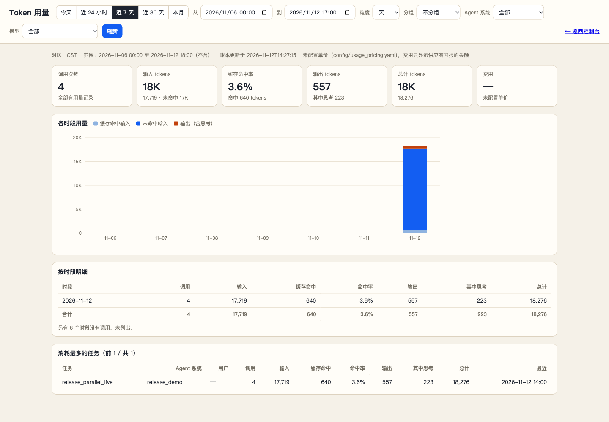
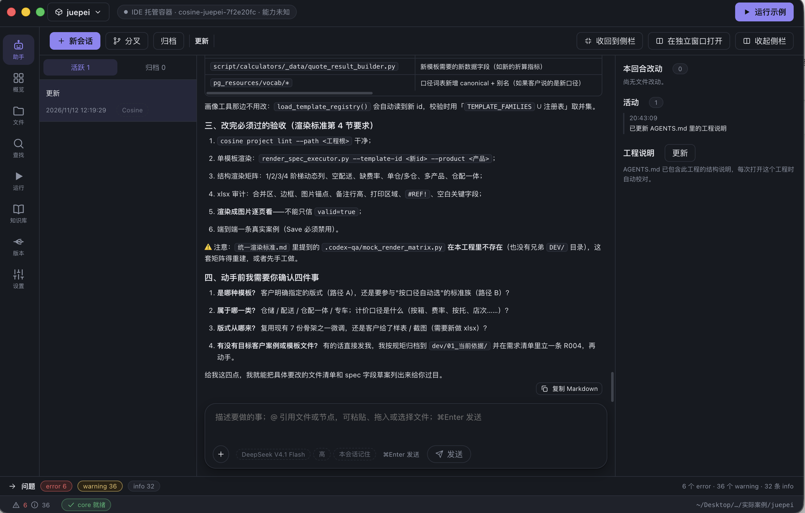
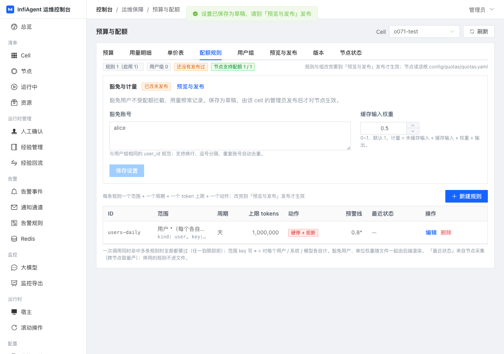

<div align="center">
  

  <h1>MLA V3 - 打造专属领域的 SOTA 级智能体</h1>

  <p>
    
    
    
  </p>

  <p>
    <a href="README.md">English</a> | <a href="README_CN.md">简体中文</a>
  </p>
</div>

---

## 🌟 简介

**InfiAgent，也称 MLA（Multi-Level Agent，多层级智能体）**，面向长时间运行的通用与领域智能体。通过 YAML 配置智能体职责、提示词和工具，将复杂任务拆成可委派的步骤，把过程与产物保存在文件中，让下一步只读取需要的上下文。

### 核心特性

- ✅ **长任务执行**：Thinking、ReAct 和 ReAct Lite 三种循环，结合动作窗口、文件交接与上下文压缩，支持持续推进复杂任务。
- ✅ **层级编排与并行协作**：保留 Researcher 的多层级结构与 OpenCowork 的通用助手配置；支持同名子智能体多实例、后台执行、结果汇合与取消。
- ✅ **可恢复会话**：原子保存状态和工具回执，中断后续跑；执行结果不明的副作用调用会明确报告，供开发者核查。
- ✅ **持久记忆与工作区**：会话保留各自记录，多个会话可共享同一工作区的工程文件与产物。
- ✅ **Agent Skills 与工具扩展**：兼容 [Agent Skills 标准](https://agentskills.io/)，支持自定义 Python 工具和 MCP。
- ✅ **开发运行界面**：黄色运行页面集成会话、文件、人工交互、五类模型 API 配置和用量面板。

### 更新 & 新闻🔥

- **3.13.0 运行时更新**：并行子智能体、可靠的会话恢复、本地共享工作区、黄色开发运行界面、五类模型配置与用量统计。安装方式见下方快速开始，变更记录见 [CHANGELOG](CHANGELOG.md)。
- **2026/07**：运行内核、Python SDK、模型多平台故障转移与经验存储更新。
- **2026/03**：Thinking / ReAct 模式切换、历史任务检索，以及按智能体配置执行、思考、压缩和图像模型。
- **2026/02**：加入 Agent Skills、多供应商模型支持与桌面应用集成。
- **2026/01**：发布 OpenCowork 与论文 [InfiAgent: An Infinite-Horizon Framework for General-Purpose Autonomous Agents](https://arxiv.org/abs/2601.03204)。

**OpenCowork 演示：文件整理与 PPT 制作**

以下保留原版演示，展示典型任务与产物；视频中的界面可能与当前版本不同。

[](https://www.youtube.com/watch?v=IuTVRPIIW-s)

[](https://www.youtube.com/watch?v=uuxAvCLIX9M)

[原版写作演示（Bilibili）](https://www.bilibili.com/video/BV142vQB2EDu/)

## 🎬 输出

原版 Researcher 演示生成的论文产物：

**Demo 1:**

<p align="center">
  
</p>

**Demo 2:**

<p align="center">
  
</p>

MLA 处理整个研究工作流程——从文献搜索和实验设计到代码执行、图表生成和 LaTeX 论文撰写。全部通过多层级智能体自动编排完成。
演示视频和大体积 GIF 现已移出 git 历史，以便更轻量地克隆仓库。

---

## 📚 目录

- [输出](#-输出)
- [快速开始](#-快速开始)
- [工作原理](#-工作原理)
- [界面截图](#-界面截图)
- [配置指南](#-配置指南)
- [CLI 界面](#-cli-界面)
- [SDK 集成](#-sdk-集成)
- [示例输出](#-示例输出)
- [项目延伸](#-项目延伸)

---

## 🚀 快速开始

### 方式 1：Docker 开发运行界面

镜像包含 Python 运行时、浏览器与文档工具。将工作数据挂载到 `user_root`：

```bash
mkdir -p user_root
docker run -d --name infiagent \
  -p 127.0.0.1:4260:4260 \
  -v "$PWD/user_root:/data/user_root" \
  chenglinhku/mlav3:3.13.0
```

打开 [http://localhost:4260](http://localhost:4260)，点击 **模型 API 配置**，填写模型名、API 地址与密钥；选择 **Agent System** 和 **Agent Name** 后创建任务，点击 **Stream Send** 开始运行。**Usage Panel** 查看用量。

执行、思考、压缩、读图、文生图可分别配置，共用或独立设置连接。工作区和文件通过挂载目录持久保存。

**Windows PowerShell：**

```powershell
New-Item -ItemType Directory -Force user_root
docker run -d --name infiagent `
  -p 127.0.0.1:4260:4260 `
  -v "${PWD}/user_root:/data/user_root" `
  chenglinhku/mlav3:3.13.0
```

**Docker CLI 模式：**

```bash
docker run -it --rm \
  -v "$PWD/user_root:/data/user_root" \
  chenglinhku/mlav3:3.13.0 cli
```

完整操作、升级与挂载说明见 [Docker 指南](docs/DOCKER_GUIDE.md)。

### 方式 2：本地 Python 安装

需要 Python 3.10 或更高版本。

```bash
pip install infiagent==3.13.0
infiagent-runtime --user-root ./user_root
```

在浏览器中配置模型后，使用 Python SDK 调用相同的 `user_root`。`infiagent` 打开交互式 CLI；源码开发可使用 `pip install -e .`。

---

## 🎯 工作原理

MLA 的设计理念是**"为下一步提供简短但高价值的上下文"**。为实现这一理念，框架实现了多项创新：

### 1. 🌲 层级与并行多智能体系统

MLA 在**树形层级结构**中部署智能体（例如，祖父 → 父亲 → 儿子）。这确保了：

- ✅ **单一目的智能体**：每个智能体都有专注的角色
- ✅ **最小工具集**：智能体仅访问必要的工具
- ✅ **并行协作**：独立子实例分工执行，父智能体收集结果；共享文件需遵循工作区并发规则
- ✅ **明确委派**：父智能体编排子智能体

**示例层级：**
```
alpha_agent（Level 3）
  ├── data_collection_agent（Level 2）
  │   └── web_search_agent（Level 1）
  ├── coder_agent（Level 2）
  └── material_to_document_agent（Level 2）
```

### 2. 🎯 嵌套注意力机制

长文档（PDF、小说、论文）可以通过工具按需读取。相反：

- ✅ 使用 `answer_from_pdf`、`answer_from_document` 工具
- ✅ 查询驱动的内容提取
- ✅ 仅相关摘录或摘要进入上下文
- ✅ **应用层通过工具进行注意力分配**

**传统方法：**
```
加载整个 50 页 PDF → 智能体处理所有内容 → Token 溢出
```

**MLA 方法：**
```
智能体问："方法是什么？"
→ 工具提取相关部分（2 页）
→ 返回简洁答案 → 最小 token 使用
```

### 3. 📁 文件中心架构

**"文件即一切。"** 所有输出和交互都保存到文件系统：

- ✅ 网页抓取 → 保存为 Markdown 文件
- ✅ PDF 解析 → 提取到结构化文档
- ✅ 子智能体结果 → 存储为文件
- ✅ 大结果保留完整文件，向上下文返回受限预览

**优势：**
- 清晰的审计跟踪
- 可重用的工件
- 无上下文状态表示

### 4. ⚡ 动作窗口与思考节奏

文件保存任务产物，运行记录保存过程；下一步只需带入当前目标、相关文件和近期动作。

- **Thinking**：先规划，再按配置的节奏执行和复盘。
- **ReAct / ReAct Lite**：围绕工具调用推进循环，按任务选择反思方式。
- `action_window_steps` 与 `thinking_interval` 控制窗口和思考间隔，必要时使用上下文压缩。
- 历史记录留在本地，超出当前上下文窗口的信息可按需检索。

```text
确定目标 → 执行若干步 → 将产物写入文件
         → 更新当前状态 → 带入相关记录，继续执行
```

### 5. 🔧 批量文件操作

受 [Claude Code](https://www.anthropic.com/) 启发，MLA 使用**基于列表的工具参数**来节省 token：

- ✅ 一次调用读取多个文件
- ✅ 批量操作减少累积 token 消耗
- ✅ 重复操作显著节省 token

**示例：**
```python
# 传统：3 次单独调用
file_read(path=["file1.txt"])
file_read(path=["file2.txt"])
file_read(path=["file3.txt"])

# MLA：1 次批量调用
file_read(path=["file1.txt", "file2.txt", "file3.txt"])
```

### 6. 💾 会话记忆与共享工作区

`task_id` 标识持久会话，同一 ID 可继续已有记录。`workspace_id` 将多个会话绑定到同一份工作文件，同时保留各自的执行记录。

```python
agent.create_workspace("research", title="Research project")
agent.run("收集论文并保存笔记", task_id="./user_root/tasks/collect", workspace_id="research")
agent.run("根据已有笔记写综述", task_id="./user_root/tasks/write", workspace_id="research")
```

同一工作区默认顺序运行。需要并发时，可选择工作区并发模式，并确认自定义工具支持并发访问。

### 7. 📊 基于调用图的共享上下文

`hierarchy_manager` 维护**动态调用关系图**：

- ✅ 跟踪父子智能体关系
- ✅ 将调用图注入共享上下文
- ✅ 防止智能体越界
- ✅ 在多智能体系统中保持任务对齐

**调用图示例：**
```json
{
  "current_agent": "coder_agent",
  "parent": "alpha_agent",
  "siblings": ["data_collection_agent", "material_to_document_agent"],
  "allowed_tools": ["python_run", "file_write", "file_read"]
}
```

运行时检查 `available_tools`，阻止范围外的调用；并行实例使用独立身份记录父子关系。

---


## 📸 界面截图

### 模型配置与用量面板

黄色开发运行页面可分别配置执行、思考、压缩、读图和文生图模型。下图为实际配置窗口，密钥不会回填显示：

<p align="center"></p>

用量面板显示时间分布、缓存命中、模型与任务明细。下图来自一次包含两个并行子智能体的实际测试运行：

<p align="center"></p>

### CLI 界面

MLA 提供了功能丰富的交互式 CLI，支持实时任务监控、HIL 处理和智能体切换：

**系统选择：**
<p align="center">
  
</p>

**工具模式配置：**
<p align="center">
  
</p>

**启动任务：**
<p align="center">
  
</p>

*基于 prompt_toolkit 和 rich 的交互式 CLI - 支持多轮对话、自动 HIL 检测和工具执行确认。*

### VS Code 集成示例

使用 MLA 的 JSONL 模式构建强大的 IDE 扩展：

<p align="center">
  
</p>

*由 MLA 驱动的 VS Code 扩展 - 与工作空间上下文无缝集成，支持实时流式输出。*

---

## ⚙️ 配置指南

智能体和工具使用 YAML 配置。首次启动后，用户目录包含：

```text
user_root/
├── config/
│   ├── llm_config.yaml
│   └── app_config.json
├── agent_library/
│   ├── Researcher/
│   │   ├── general_prompts.yaml
│   │   ├── level_0_tools.yaml
│   │   ├── level_1_agents.yaml
│   │   ├── level_2_agents.yaml
│   │   └── level_3_agents.yaml
│   └── OpenCowork/
├── tools_library/
├── skills/
├── tasks/
└── workspaces/
```

### 关键配置文件

#### 1. `llm_config.yaml` — 模型配置

推荐从页面填写。下面是五类模型的 YAML 结构，模型名和连接地址需替换成实际服务：

```yaml
api_key: "your-api-key"
base_url: "https://your-provider.example/v1"
models:
  - "openai/your-execution-model"
thinking_models:
  - "openai/your-thinking-model"
compressor_models:
  - "openai/your-compression-model"
read_figure_models:
  - "openai/your-vision-model"
figure_models:
  - name: "openai/your-image-model"
    base_url: "https://your-image-provider.example/v1"
    api_key: "your-image-api-key"
    image_api: "images"
multimodal: false
compressor_multimodal: false
```

每类模型可共享默认连接，也可在条目中单独设置 `api_key` / `base_url`。读图和文生图应使用具备对应能力的模型；文生图接口可选 `images` 或 `chat`。智能体配置中的模型覆盖项优先于角色默认值。

#### 2. 智能体层级

MLA 将智能体组织成层级：

- **Level 3**：顶层编排者（如 `alpha_agent`）
- **Level 2**：功能专家（如 `data_collection_agent`、`coder_agent`）
- **Level 1**：基础执行者（如 `web_search_agent`）
- **Level 0**：工具定义
- **Level -1**：质量控制（如 `judge_agent`）

#### 3. 创建自定义智能体

在智能体系统的层级 YAML 中定义职责、工具和参数，例如：

```yaml
tools:
  notes_agent:
    type: llm_call_agent
    level: 1
    name: notes_agent
    description: Read project files and write notes.
    available_tools:
      - file_read
      - file_write
      - final_output
    prompts:
      agent_responsibility: Read project files and write concise notes.
    parameters:
      type: object
      properties:
        task_id:
          type: string
        task_input:
          type: string
      required: [task_id, task_input]
```

并行委派可使用 `spawn_subagents`、`collect`、`cancel`；被调用的子智能体必须在父智能体的可用工具集合中。详见 [SDK 指南](docs/SDK_GUIDE.md)。

---

## 💻 CLI 界面

### 交互模式

启动 CLI 进行对话式体验：

```bash
mla-agent --cli
```

**主要功能：**

- 🔄 **多轮对话**，持久化上下文
- 🤖 **智能体切换**，使用 `@agent_name` 语法
- 🔔 **自动 HIL 检测**，带音频提醒
- ⚠️ **工具执行确认**，手动模式下
- ⏸️ **中断和恢复**支持（Ctrl+C 暂停）
- 🎨 **丰富的终端 UI**，基于 `prompt_toolkit` 和 `rich`

**使用示例：**

```bash
# 直接输入任务（使用默认智能体）
[alpha_agent] > 收集有关 Transformer 的论文

# 切换智能体并执行任务
[alpha_agent] > @data_collection_agent 搜索最近的 NLP 论文

# 仅切换默认智能体
[alpha_agent] > @coder_agent
✅ 已切换到：coder_agent
[coder_agent] >
```

**CLI 命令：**

| 命令 | 描述 |
|------|------|
| `/help` | 显示帮助和可用命令 |
| `/agents` | 列出所有可用智能体 |
| `/resume` | 恢复中断的任务 |
| `/quit` 或 `/exit` | 退出 CLI 模式 |
| `Ctrl+C` | 中断当前任务（保持在 CLI 中） |
| `Ctrl+D` | 立即退出 CLI |

**人机交互（HIL）处理：**

当智能体请求人工输入时，CLI 会自动检测：

```
🔔🔔🔔 检测到 HIL 任务！按回车处理... 🔔🔔🔔
================================================================================
🔔 人类交互任务（HIL）
================================================================================
📝 任务 ID：upload_file_20250124
📋 指令：请上传所需的数据集文件...
================================================================================
💡 输入你的响应（任何文本）
   输入 /skip 跳过此任务
================================================================================

[alpha_agent] HIL 响应 > 文件已成功上传
✅ HIL 任务已响应
```

**工具确认（手动模式）：**

当设置 `--auto-mode false` 时，每次工具执行都需要确认：

```
⚠️⚠️⚠️ 检测到工具执行请求！按回车确认... ⚠️⚠️⚠️
================================================================================
⚠️  工具执行确认请求
================================================================================
🔧 工具名称：python_run
📝 确认 ID：confirm_12345
📋 参数：
     code: import numpy as np...
     timeout: 300
================================================================================
💡 选择操作：
   yes / y - 批准执行
   no / n  - 拒绝执行
================================================================================

[alpha_agent] 确认 [yes/no] > yes
✅ 已批准执行工具：python_run
```

---

### 命令行模式

用于脚本和自动化：

```bash
mla-agent \
  --task_id /path/to/workspace \
  --user_input "你的任务描述" \
  --agent_name alpha_agent
```

**常用参数：**

| 参数 | 描述 | 默认值 |
|------|------|--------|
| `--task_id` | 工作空间路径（绝对路径） | 必需 |
| `--user_input` | 任务描述 | 必需 |
| `--agent_name` | 调用的智能体 | `alpha_agent` |
| `--agent_system` | 智能体库名称 | `Researcher` |
| `--cli` | 交互式 CLI 模式 | `false` |
| `--jsonl` | JSONL 输出模式 | `false` |
| `--force-new` | 清空所有状态并重新开始 | `false` |
| `--auto-mode` | 工具执行模式（`true`/`false`） | 自动检测 |

**自动模式示例：**

```bash
# 自动执行工具（无需确认）
mla-agent --task_id ~/project --user_input "任务" --auto-mode true

# 每个工具需手动确认
mla-agent --task_id ~/project --user_input "任务" --auto-mode false
```

---

### 运行时工具执行

```bash
# 工具通过进程内 direct-tools 执行
# 不再需要单独启动 mla-tool-server 进程
```

---

## 🔌 SDK 集成

MLA 提供两种 SDK 选项：**Python SDK** 用于直接集成，**JSONL 模式**用于 IDE 插件。

---

### Python SDK

当前推荐直接使用内置的 `infiagent` SDK。现在的 SDK 语义是：

- `infiagent(...)` 负责描述运行时默认配置
- `run(...)`、`fresh(...)`、`add_message(...)` 等方法负责绑定具体 `task_id`
- 可以通过 `user_data_root` 切换整套运行时目录

最小示例：

```python
from infiagent import infiagent

agent = infiagent(
    user_data_root="/abs/path/to/my_root",
    default_agent_system="Researcher",
    default_agent_name="alpha_agent",
    action_window_steps=30,
    thinking_interval=30,
    max_turns=100000,
    fresh_enabled=True,
    fresh_interval_sec=300,
)

result = agent.run(
    "写一篇关于 Transformer 的综述论文",
    task_id="/abs/path/to/tasks/transformer_survey",
)

print(f"状态：{result['status']}")
print(f"输出：{result['output']}")
```

如果你的 `user_data_root` 已经包含：

- `config/llm_config.yaml`
- `config/app_config.json`
- `agent_library/...`
- `tools_library/...`

通常不需要再重复传入 `llm_config_path`、`agent_library_dir`、`tools_dir`。

常用任务接口：

```python
# 对运行中或已停止的 task 发起 fresh / resume。
agent.fresh(
    task_id="/abs/path/to/tasks/transformer_survey",
    reason="reload runtime config",
)

# 向同一个 task（不是 task_id正在运行中的智能体） 追加新指令。
agent.add_message(
    "保留已有大纲，只修改第三节。",
    task_id="/abs/path/to/tasks/transformer_survey",
    source="user",
    resume_if_needed=True,
)

# 启动独立后台进程；同一 task_id 同时只能由一个执行者运行。
agent.start_background_task(
    task_id="/abs/path/to/tasks/subtask_eval",
    user_input="后台运行评测流程并总结结果",
    force_new=True,
)

# 获取 task 快照，适合面板和轻量 watchdog。
snapshot = agent.task_snapshot(
    task_id="/abs/path/to/tasks/transformer_survey",
)

# 重置损坏的 task 状态，可选保留 history。
agent.reset_task(
    task_id="/abs/path/to/tasks/transformer_survey",
    reason="clear broken loop",
    preserve_history=True,
)
```

运行时自省：

```python
runtime = agent.describe_runtime()
print(runtime["user_data_root"])
print(runtime["agent_library_dir"])
print(runtime["tools_dir"])

systems = agent.list_agent_systems()
print(systems["systems"])
```

SDK 目前支持的高级能力：

- 基于 `task_id` 的后台启动、resume 和 fresh
- 基于 `user_data_root` 的 conversations、logs、runtime、config 隔离
- 工具调用前后 hook
- LLM 调用前的 context hook，可读取并改写最终 prompt
- 通过 `mcp_servers=[...]` 为实例注入 MCP 运行时配置

完整说明见：[docs/SDK_GUIDE.md](docs/SDK_GUIDE.md)

**Python SDK 使用场景：**
- 🔧 构建自定义工作流
- 🤖 在现有应用中嵌入智能体
- 📊 批量处理多个任务
- 🧭 构建外部面板、watchdog 和调度层
- 🔬 程序化控制的研究实验

---

### JSONL 模式（IDE 插件）

MLA 提供 JSONL 流式模式，用于与 IDE 和编辑器实时集成：

```bash
mla-agent \
  --task_id $(pwd) \
  --user_input "优化代码性能" \
  --jsonl 2>/dev/null
```

**输出格式：**

```jsonl
{"type":"start","call_id":"c-1760936557-474c43","project":"~/project","agent":"alpha_agent","task":"优化..."}
{"type":"token","text":"[alpha_agent] 正在分析代码..."}
{"type":"progress","phase":"execution","pct":30}
{"type":"token","text":"调用工具：code_analyzer"}
{"type":"result","ok":true,"summary":"优化完成"}
{"type":"end","status":"ok","duration_ms":5432}
```

**事件类型：**

| 事件类型 | 描述 | 关键字段 |
|----------|------|----------|
| `start` | 任务开始 | `call_id`、`agent`、`task` |
| `token` | 流式文本输出 | `text` |
| `progress` | 进度更新 | `phase`、`pct` |
| `result` | 任务结果 | `ok`、`summary` |
| `end` | 任务完成 | `status`、`duration_ms` |
| `error` | 发生错误 | `message` |

---

### TypeScript/JavaScript 集成

```typescript
import { spawn } from 'child_process';

interface AgentEvent {
  type: 'start' | 'token' | 'progress' | 'result' | 'end' | 'error';
  [key: string]: any;
}

function runAgent(
  workspacePath: string,
  userInput: string,
  onEvent: (event: AgentEvent) => void
): Promise<AgentEvent> {
  return new Promise((resolve, reject) => {
    const child = spawn('mla-agent', [
      '--task_id', workspacePath,
      '--user_input', userInput,
      '--jsonl'
    ]);

    let buffer = '';

    child.stdout.on('data', (data) => {
      buffer += data.toString();
      const lines = buffer.split('\n');
      buffer = lines.pop() || '';

      lines.forEach(line => {
        if (!line.trim()) return;

        try {
          const event: AgentEvent = JSON.parse(line);
          onEvent(event);

          if (event.type === 'end') {
            resolve(event);
          } else if (event.type === 'error') {
            reject(new Error(event.message));
          }
        } catch (e) {
          console.error('解析事件失败：', line);
        }
      });
    });

    child.stderr.on('data', (data) => {
      // 将错误记录到 stderr
      console.error(data.toString());
    });

    child.on('error', reject);
  });
}

// 使用示例
await runAgent('/path/to/workspace', '编写单元测试', (event) => {
  switch (event.type) {
    case 'start':
      console.log(`任务开始：${event.task}`);
      break;
    case 'token':
      process.stdout.write(event.text);
      break;
    case 'progress':
      updateProgressBar(event.pct);
      break;
    case 'result':
      console.log(`\n结果：${event.summary}`);
      break;
  }
});
```

---

### VS Code 扩展示例

使用 MLA 构建你自己的 Cursor/VS Code 扩展：

**扩展功能：**
- 🤖 命令面板中的智能体命令
- 💬 带工作空间上下文的内联聊天
- 📝 自动代码生成和重构
- 🔍 编辑器内文献搜索
- 🔔 带 UI 提示的 HIL 任务处理

**基本扩展结构：**

```typescript
// extension.ts
import * as vscode from 'vscode';
import { runAgent } from './mla-client';

export function activate(context: vscode.ExtensionContext) {
  let disposable = vscode.commands.registerCommand(
    'mla.executeTask',
    async () => {
      const workspace = vscode.workspace.workspaceFolders?.[0].uri.fsPath;
      const input = await vscode.window.showInputBox({
        prompt: '输入任务描述'
      });

      if (!workspace || !input) return;

      // 显示进度
      await vscode.window.withProgress({
        location: vscode.ProgressLocation.Notification,
        title: 'MLA 智能体',
        cancellable: true
      }, async (progress, token) => {

        await runAgent(workspace, input, (event) => {
          if (event.type === 'token') {
            vscode.window.showInformationMessage(event.text);
          } else if (event.type === 'progress') {
            progress.report({ increment: event.pct });
          }
        });
      });
    }
  );

  context.subscriptions.push(disposable);
}
```

---

## 📊 示例输出

### 学术论文输出

MLA 可以生成具有以下结构的完整研究论文：

```
upload/
├── paper.tex               # 主 LaTeX 文档
├── references.bib          # 参考文献
├── figures/
│   ├── architecture.png
│   ├── results_comparison.png
│   └── ablation_study.png
└── supplementary/
    └── detailed_results.pdf
```

**质量指标：**
- ✅ 通过 EI/IEEE 会议的同行评审
- ✅ 正确的引用格式
- ✅ 高质量图表（300 DPI）
- ✅ 连贯的结构和流程

### 其他能力

**1. 科学计算**
- ECM 蛋白质组成仿真
- 物流公司排班调度
- 学生作业批改与反馈

**2. 通用任务**
- 网页抓取和数据提取
- 代码生成和调试
- 文档转换和处理

---


## 🌱 项目延伸

**状态：原型开发与测试中。** 围绕 InfiAgent，我们正在探索从智能体工程编辑、运行验证到平台管理的完整开发流程。

### Cosine：智能体工程开发

将工程编辑、内嵌助手、配置与工具修改、文件管理和容器内试运行放在同一工作流中。下图展示正在开发的助手界面：



### 可复用的端到端测试与修复

复用工程配置、运行环境和测试样例，让助手执行真实任务、检查过程与产物、定位问题、修改工具或提示词，再运行同一组样例验证结果。测试材料与修复记录随工程积累。

### 运维控制台与高可用运行平台

探索多节点运行、任务故障接管，以及节点、配置、版本、权限、数据源与用量管理。下图为配额管理的原型测试界面：



更多方向与状态见 [项目延伸](docs/PLATFORM_OVERVIEW.md)。

---

## 📖 文档

- 运行时工具通过 direct-tools 进程内执行，不再需要单独的 tool server。
- [SDK 指南](docs/SDK_GUIDE.md) — Python 调用、并行编排、工作区与人工交互
- [Docker 指南](docs/DOCKER_GUIDE.md) — 运行界面与部署
- [事件格式](docs/EVENT_SCHEMA.md) · [用量统计](docs/USAGE.md)
- [配置示例](config/agent_library/Researcher/) - 智能体 YAML 模板

---

## 🤝 贡献

欢迎贡献！请随时提交问题或拉取请求。

---

## 📄 许可证

详见 [LICENSE](LICENSE)

---

## 📄 引用

如果您在研究中使用了 InfiAgent，请引用我们的论文：

```bibtex
@article{yu2026infiagent,
  title={InfiAgent: An Infinite-Horizon Framework for General-Purpose Autonomous Agents},
  author={Yu, Chenglin and Wang, Yuchen and Wang, Songmiao and Yang, Hongxia and Li, Ming},
  journal={arXiv preprint arXiv:2601.03204},
  year={2026}
}
```

---

## 🙏 致谢

- 使用 [LiteLLM](https://github.com/BerriAI/litellm) 统一 LLM 访问
- 使用 [Crawl4AI](https://github.com/unclecode/crawl4ai) 进行网页抓取

---

感谢贡献者：@yuchenglin @wangyuchen @wangsongmiao @yuyang @lijinjia
